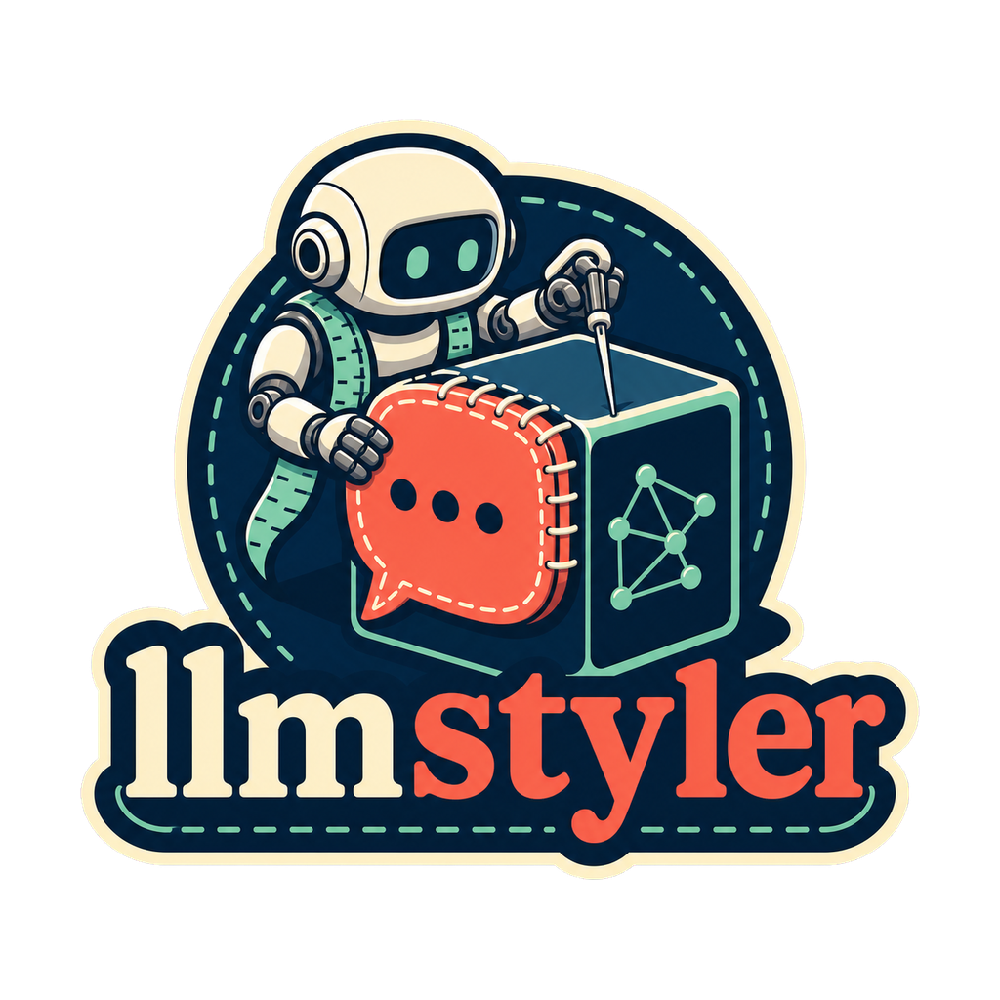

<p align="center">
  
  <br />
  <!-- repo-tagline:start -->
  <strong>🧵 Change how your LLM talks 🧵</strong>
  <!-- repo-tagline:end -->
</p>

llmstyler builds speaking-style fine-tuning datasets. It compiles reusable
style packs, rewrites selected assistant responses through AgentBridge, and
generates Runbook training configs for Unsloth QLoRA.

## Quickstart

From the checkout, with Python 3.11 or newer and uv:

```bash
uv sync --config-file uv.toml --frozen --all-extras
uv run --frozen llmstyler preview --style styles/warm-direct.yaml --compile-only
```

This prints the compiled conversation without making a model call. Edit a pack
to change its style instructions or examples.

See the [workflow guide](https://github.com/tsilva/llmstyler/blob/main/docs/guide.md)
for live previews, AgentBridge configuration, dataset generation, and training.
The [Studio experiment](https://github.com/tsilva/llmstyler/blob/main/docs/studio-experiment.md)
documents the optional Unsloth Studio path.

## License

[MIT License](https://github.com/tsilva/llmstyler/blob/main/LICENSE).
