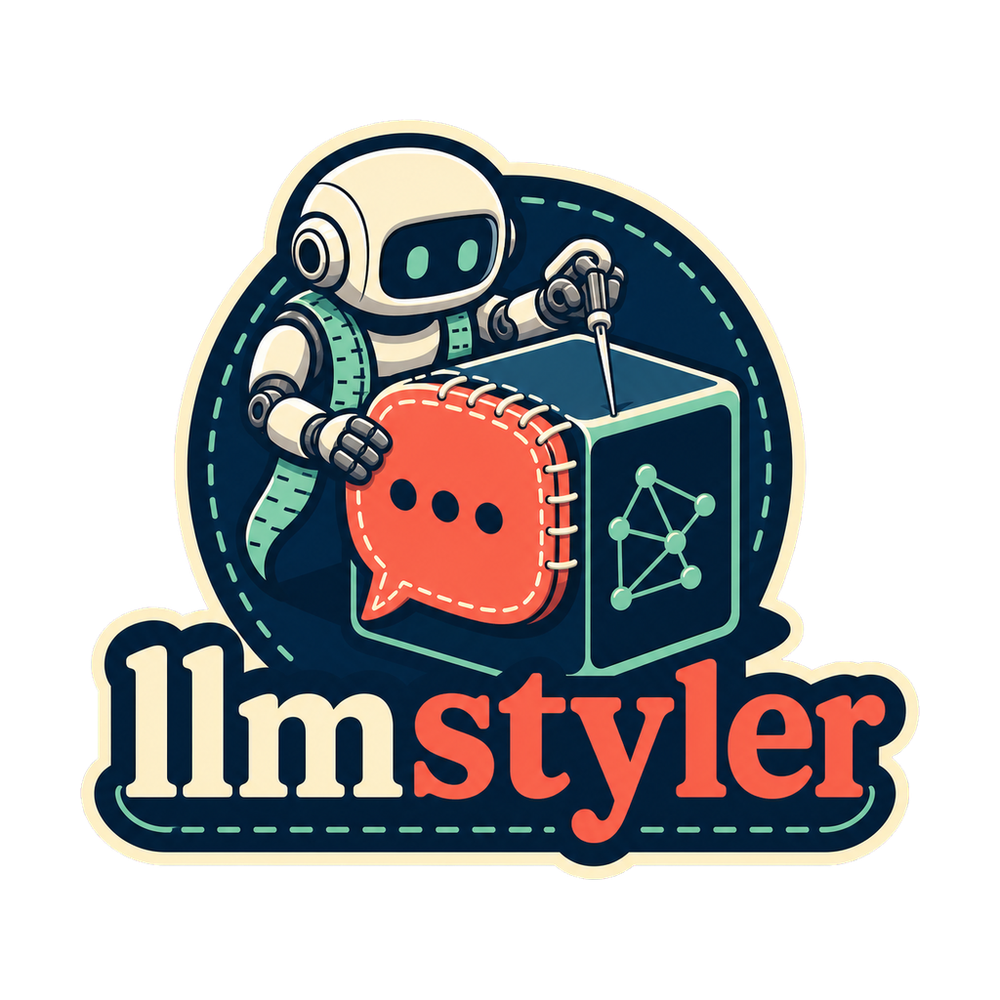
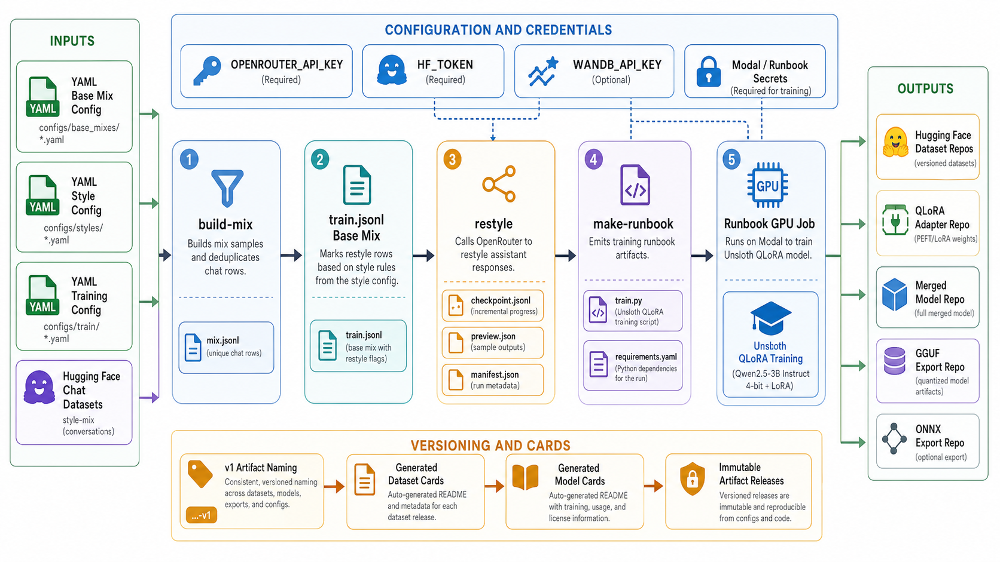

<p align="center">
  
  <br />
  <!-- repo-tagline:start -->
  <strong>🧵 Change how your LLM talks 🧵</strong>
  <!-- repo-tagline:end -->
</p>

llmstyler is a Python CLI for building speaking-style supervised fine-tuning
datasets and publishing the resulting model artifacts. It starts with YAML
configs, uses datamixxer to sample chat rows from Hugging Face datasets, rewrites selected
assistant responses through AgentBridge, and generates Runbook training files for
Unsloth QLoRA jobs.

The main workflow is: build a reusable base mix, restyle the marked rows, then
launch a Runbook training step that publishes versioned Hugging Face datasets and
model exports.

## Install

Dependency resolution keeps the seven-day release-age setting in `uv.toml` and
the security constraints in `[tool.uv]` in `pyproject.toml`. Keep both files with
the committed `uv.lock` when updating dependencies.

```bash
git clone https://github.com/tsilva/llmstyler.git
cd llmstyler
uv sync --config-file uv.toml --frozen --all-extras
source .venv/bin/activate
```

Run the CLI from the repo root:

```bash
llmstyler --help
```

## Agent-operated local mode

Use the explicit agent entrypoint for keyless calls to the reviewed local gateway:

```bash
uv run --frozen python scripts/agent.py check
uv run --frozen python scripts/agent.py run preview --style styles/warm-direct.yaml
uv run --frozen python scripts/agent.py run doctor --no-run
```

This mode permits only `http://127.0.0.1:8082/api/v1` and its chat/models routes.
It strips inherited service credentials and proxy settings, ignores dotenv files,
and rejects authentication headers, endpoint overrides and redirects. Models,
prompts and rewrite-cache behavior are unchanged. It does not provide OS isolation.
The ordinary `llmstyler` CLI and SDK retain their operator authentication and
custom-endpoint contracts outside this explicit mode.

Hugging Face access/publishing, external datamixxer execution and remote Runbook
training fail closed in agent mode until their transports have separately reviewed
credential routes. No route or live provider operation is established by this change.
The deprecated `scripts/infisical.py` path delegates to the same keyless launcher;
its former secret retrieval and `add` operation are retired. The original project
metadata is preserved unchanged as [historical inventory](docs/legacy-infisical-metadata.json),
with no root operational Infisical selection or claim of native-proxy migration.
Studio owner-session and direct-OpenRouter smoke scripts now return explicit
diagnostics; use Studio's existing human sign-in flow. Trusted Studio server
authentication remains separate.

## Simplest workflow

Try a portable voice before generating a dataset. The packs in `styles/` contain
voice instructions, phrases to avoid, and example conversations. They contain no
model, credential, dataset, or infrastructure settings.

```bash
# Inspect the compiled conversation without making an API call.
llmstyler preview --style styles/warm-direct.yaml --compile-only

# Try the same pack with AgentBridge and Codex.
llmstyler preview --style styles/warm-direct.yaml
llmstyler chat --style styles/warm-direct.yaml

# Reuse that voice for dataset rewriting and fine-tuning.
llmstyler new my-style --owner your-hf-user --style-pack styles/warm-direct.yaml
```

`--style-pack` is an alternative to the raw prompt flags below. Pack paths are
stored relative to the pipeline config. Editing a pack changes the compiled
rewrite prompt the next time the pipeline runs; old rewrites are not reused
across style changes. Legacy checkpoints without a style fingerprint are
regenerated once.

Previews, chats, and dataset rewrites default to AgentBridge at
`http://127.0.0.1:8082/api/v1`, model `codex/gpt-6.1-sol`, and
`reasoning_effort: high`. Start AgentBridge with a signed-in Codex provider before
running them. These calls need no OpenRouter key. Datamixxer prepares and tags
the source rows; llmstyler owns the LLM calls. Codex rewrites use a strict JSON
schema. The default request timeout is 630 seconds and rewrites use one worker, matching
the standard AgentBridge pool. High reasoning may take several minutes; the
server's own timeout still applies. Configure `workers` and `request_timeout` in
the style settings when using a larger server pool.

Use `--model`, `--reasoning-effort`, and `--base-url` to override preview/chat
settings. Pipeline equivalents are `restyle.style.model`,
`restyle.style.reasoning_effort`, and `restyle.style.base_url`; standalone restyle
configs use `style.*`. Generated recipes and shipped examples use these defaults.
Provider, endpoint, model, reasoning, and voice changes invalidate rewrite caches.
Token estimates remain available; USD cost is unknown unless explicit
`pricing_usd_per_1m.input` and `.output` values are configured.

To retain an OpenRouter model, select its model ID through AgentBridge:

```bash
llmstyler preview --style styles/warm-direct.yaml --model openrouter/x-ai/grok-4.3
llmstyler run configs/pipelines/my-style.yaml restyle.style.model=openrouter/x-ai/grok-4.3
```

Failed gateway requests report their cause without switching endpoints.

Generated recipes restyle 20% of training rows, balanced by source bucket, and
retain the other rows unchanged. Training learns a default voice without adding
style instructions to every conversation. Set `runstep.style.system_prompt`
explicitly when experimenting with prompt-conditioned training. The existing
Trump example is a separate experiment using entirely restyled training data.

Create a complete pipeline config from a few values:

```bash
llmstyler new my-style --owner your-hf-user --style-prompt prompt.txt
```

Check local prerequisites, estimate rewrite cost, then run the local dataset
pipeline:

```bash
llmstyler doctor configs/pipelines/my-style.yaml
llmstyler estimate configs/pipelines/my-style.yaml
llmstyler run configs/pipelines/my-style.yaml
```

`llmstyler run` is local-first: it builds the base mix, restyles rows, and
generates Runbook training files without publishing. Remote training expects the
restyled dataset to be available on Hugging Face, so launch publishing and remote
training explicitly:

```bash
llmstyler run configs/pipelines/my-style.yaml --publish
```

Inspect generated artifacts and cached pipeline state:

```bash
llmstyler inspect configs/pipelines/my-style.yaml
```

## Test tuning with Unsloth Studio

`configs/pipelines/warm-direct-smoke.yaml` is a small reproducible recipe: 64
source rows, a pinned SmolTalk2 revision, 50% of training rows marked for
rewriting, and a 0.5B base model. It is for validating the workflow, not measuring
the quality of a trained voice. Run from the repository root with the updated
datamixxer CLI available on `PATH`:

```bash
llmstyler export-studio configs/pipelines/warm-direct-smoke.yaml
```

The export writes `train.jsonl`, `heldout.jsonl`, and `manifest.json` under
`runs/warm-direct-smoke/studio/`. Training rows keep the styled/unchanged blend.
Only the conversational `messages` column is exported to Studio. Exact
conversation overlap between the original train and test splits is rejected.
The destination must be empty; choose `--output-dir` for another export.

Upload **only `train.jsonl`** to Studio's training workflow. Reserve
`heldout.jsonl` for comparing the base model, prompted base model, and trained
adapter on both voice and answer quality. Studio may create a validation split
from training rows for loss monitoring; that is separate from this final test
set. `--max-rows` can limit training data for an installation smoke test.

Studio runs independently of the existing Runbook/Modal backend. See the
[Studio experiment guide](docs/studio-experiment.md) for the beast-3 setup and
the first experiment's scope.

## Advanced commands

```bash
llmstyler build-mix configs/base_mixes/smoltalk_style_mix.yaml

llmstyler restyle configs/styles/trump_public_speaking.yaml --estimate-only
llmstyler restyle configs/styles/trump_public_speaking.yaml

llmstyler run configs/pipelines/trump.yaml
llmstyler run configs/pipelines/trump.yaml --publish training.num_epochs=1

llmstyler train-style configs/pipelines/trump.yaml
llmstyler train-style configs/pipelines/trump.yaml training.num_epochs=1
llmstyler train-style configs/pipelines/trump.yaml --dry-run training.num_epochs=1
llmstyler train-style configs/pipelines/trump.yaml --force

llmstyler runstep configs/train/qwen25_3b_trump.yaml
llmstyler runstep configs/train/qwen25_3b_trump.yaml --no-run
```

## Notes

- Python 3.11 or newer is required.
- `datamixxer` is required for `llmstyler build-mix`. Install it from
  `https://github.com/tsilva/datamixxer`.
  Use a version supporting `datamixxer show --json` (artifact schema version 1).
- Example configs live under `configs/pipelines/`, `configs/base_mixes/`,
  `configs/styles/`, and `configs/train/`.
- `llmstyler new` writes full pipeline YAML from a compact set of flags. The
  generated config keeps dataset publishing disabled by default; pass
  `llmstyler run ... --publish` when you want Hub uploads and remote training.
- `AGENTBRIDGE_API_KEY` is optional gateway authentication. Estimates make no LLM
  calls; `doctor` checks gateway readiness. Upstream keys stay in AgentBridge.
- `llmstyler train-style` composes a full pipeline config with OmegaConf, so any
  nested value can be overridden from the CLI with dotlist syntax such as
  `owner=my-hf-org`, `model.base_model=...`, `training.num_epochs=1`, or
  `exports.adapter.enabled=true`.
- `llmstyler train-style` records per-step hashes in
  `runs/<pipeline-id>/pipeline/status.json`. A step is skipped when its resolved
  config hash is unchanged and its expected artifacts still exist. Use `--force`
  to rerun everything.
- `HF_TOKEN`, or an authenticated Hugging Face CLI session, is required because
  dataset and model artifact publishing is enabled by default in pipeline configs. Pass
  `--no-push-to-hub` to dataset commands for local-only runs. Publishing commands
  preflight Hugging Face auth and repository creation before running expensive
  generation work.
- Hub uploads are public by default. Set `hub.private: true` in a dataset config
  only when the target repository should be private.
- `llmstyler runstep` writes the generated Runbook files and launches `runbook`
  with the GPU, timeout, output notebook path, and secrets from the training
  config. Use `--no-run` to generate files without launching remote training.
- The `runbook` CLI must be installed before launching a runstep. Install it
  from `https://github.com/tsilva/runbook`.
- Remote training expects Modal/Runbook secrets named `huggingface-secret` and
  optionally `wandb-secret`.
- Generated local artifacts are ignored by git: `datasets/`, `runs/`, and
  `outputs/`.
- Published artifact names should be immutable and versioned, such as
  `owner/style-mix-restyled-name-v1` and `owner/model-style-gguf-v1`.
- `llmstyler build-mix` writes the datamixxer artifact under
  `.datamixxer/mixes/<hash>/` and mirrors it to `datasets/basemix_restyle/` for
  restyle configs.
- Restyle outputs include a checkpoint, preview file, manifest, and dataset card.
  Training publishes Q4_K_M GGUF by default; adapter, merged, and ONNX uploads
  are opt-in export settings.

## Architecture



## Single AgentBridge route

Preview, chat, and dataset rewriting use only AgentBridge. The `--provider`
selector and direct OpenRouter backend have been removed. Keep existing model
choices in `--model` or the style configuration; upstream model IDs gain
`openrouter/` on gateway requests. Set `AGENTBRIDGE_BASE_URL` (default
`http://127.0.0.1:8082/api/v1`) and optionally `AGENTBRIDGE_API_KEY` for gateway
authentication. Upstream provider credentials belong to AgentBridge.

## License

No license file is present in this repository.

[MIT License](LICENSE).
